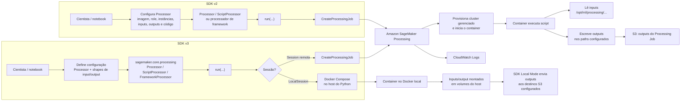
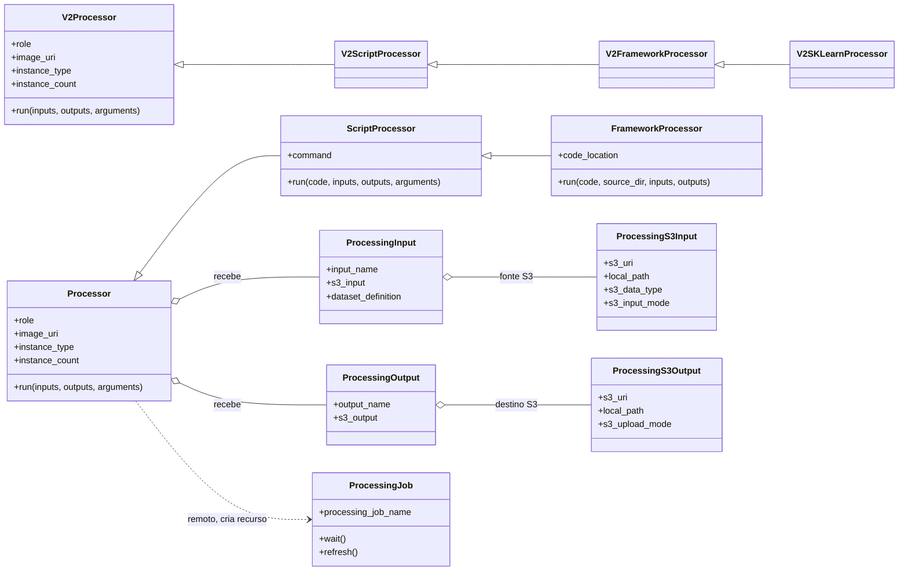
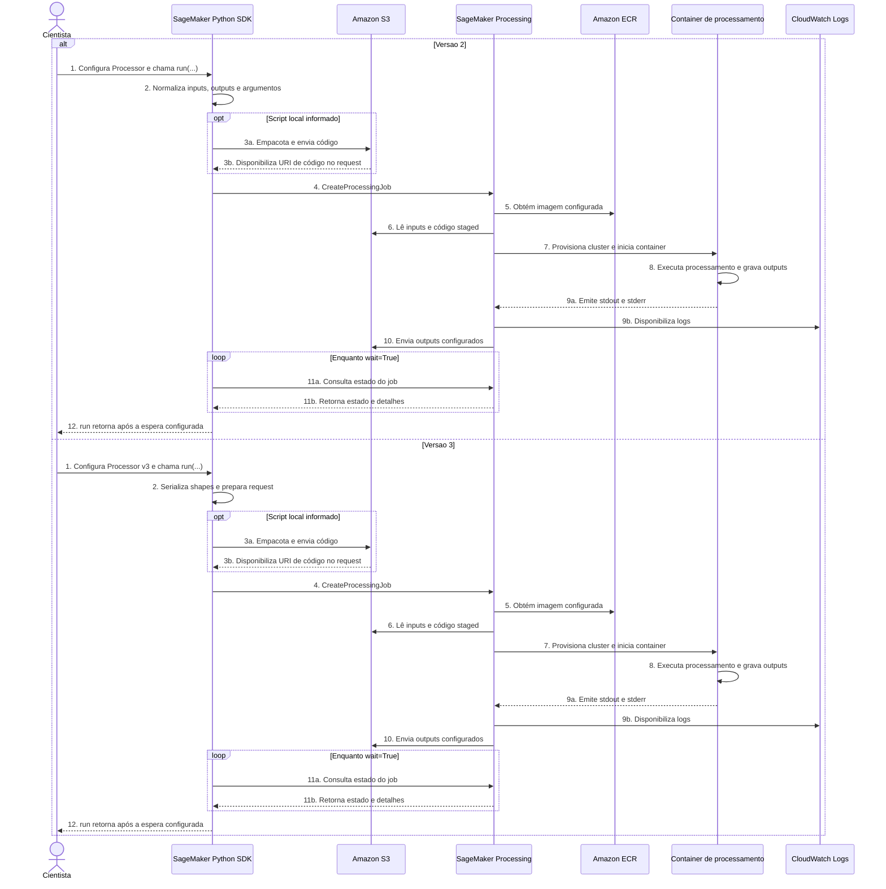

# Relatório: execução de Processing Jobs com SageMaker Python SDK v3

**Escopo:** mudanças da API v2 para v3, arquitetura, execução, código e
considerações práticas para cientistas de dados. O relatório reflete as APIs
presentes neste checkout do repositório.

## Resumo executivo

Um Processing Job executa um container para tarefas como preparação e
validação de dados, engenharia de atributos, avaliação de modelos e outras
etapas de processamento. Na v3, a API de baixo nível e os processadores estão
no pacote `sagemaker-core`; os passos de pipelines ficam no pacote
`sagemaker-mlops`.

No fluxo interativo, o padrão é configurar um `ScriptProcessor` ou
`FrameworkProcessor` e chamar `run()`. O cientista especifica a imagem, a role,
os recursos, os inputs, os outputs e o script. Para pipelines, a mesma chamada
é preparada com uma `PipelineSession` e incorporada em um `ProcessingStep`,
em vez de iniciar imediatamente o processamento.

O serviço Amazon SageMaker Processing continua sendo responsável por
provisionar os recursos, transferir os dados conforme a configuração,
executar o container e enviar outputs configurados para S3. A mudança da v3
está principalmente na organização/importação e no formato das configurações
da SDK; o contrato do container e as responsabilidades de IAM, rede, dados e
custo continuam relevantes.

## O que mudou da v2 para v3

| Tema | SDK v2 | SDK v3 |
|---|---|---|
| Processador base | `sagemaker.processing.Processor` | `sagemaker.core.processing.Processor` |
| Script genérico | `sagemaker.processing.ScriptProcessor` | `sagemaker.core.processing.ScriptProcessor` |
| Script de framework | `sagemaker.processing.FrameworkProcessor` | `sagemaker.core.processing.FrameworkProcessor` |
| Processador Scikit-learn | `sagemaker.sklearn.processing.SKLearnProcessor` | `ScriptProcessor` com imagem Scikit-learn apropriada |
| Entradas e saídas | `sagemaker.processing.ProcessingInput` / `ProcessingOutput` | Shapes em `sagemaker.core.shapes`, incluindo `ProcessingS3Input` e `ProcessingS3Output` |
| Execução direta | `processor.run(...)` | `processor.run(...)`, com tipos de configuração v3 |
| Pipeline | `sagemaker.workflow.steps.ProcessingStep` | `sagemaker.mlops.workflow.steps.ProcessingStep` |
| Sessão | `sagemaker.session.Session()` | `sagemaker.core.helper.session_helper.Session()` |
| Imagens | `sagemaker.image_uris.retrieve(...)` | `sagemaker.core.image_uris.retrieve(...)` |

O conceito do job não foi substituído: segue sendo um SageMaker Processing
Job. O que muda para o código Python é que classes antes reunidas no pacote
monolítico foram realocadas e algumas interfaces especializadas podem ser
substituídas por um processador genérico configurado com a imagem certa.
Revise a imagem ao migrar: `ScriptProcessor` não escolhe automaticamente
qualquer dependência ou imagem compatível com o script.

## Arquitetura e fluxo de execução

### Desenho da arquitetura

O diagrama mostra a sequência da configuração e submissão. O cientista inicia
o fluxo nas duas versões; a principal mudança é a organização da API Python.
No modo remoto, ambas criam um Processing Job gerenciado pelo SageMaker.



**Importante:** `LocalSession`/Local Mode é uma execução Docker no host onde
roda o processo Python, não uma instância remota SageMaker. Um notebook
executado em Studio pode ter um host AWS como cliente, mas o container ainda
é iniciado pelo Docker local desse ambiente; isso não é um Processing Job
gerenciado.

### Diagrama de classes: v2 e v3

O diagrama representa os papéis e relações conceituais; não indica que as
classes v2 sejam importáveis ou herdadas pelas classes v3.



**Leitura da migração:** `Processor`, `ScriptProcessor` e `FrameworkProcessor`
continuam representando os papéis centrais, mas seus módulos mudaram para
`sagemaker.core.processing`. As configurações de input/output agora são shapes
em `sagemaker.core.shapes`; os detalhes S3 são objetos aninhados em
`ProcessingS3Input`/`ProcessingS3Output`, em vez de se presumir um único campo
`source`/`destination` no shape externo. O processador prepara o request; o
`ProcessingJob` representa o recurso criado.

### Fluxo de um Processing Job remoto: v2 e v3

Os números do diagrama representam etapas lógicas repetidas nos dois ramos.
Subetapas condicionais aparecem com sufixos, como `3a` e `3b`.



### Descrição numerada das etapas

1. **Configuração e chamada.** O cientista escolhe imagem, role, recursos,
   entrypoint/script, inputs e outputs. Na v2 chama `processor.run(...)`; na
   v3 também usa `run(...)`, agora com imports e shapes reposicionados.
2. **Preparação do request pela SDK.** A SDK normaliza os objetos de entrada
   e saída, argumentos e configurações da sessão. A forma de expressar
   ProcessingInput/Output mudou na v3, mas a solicitação continua descrevendo
   o job para o serviço SageMaker.
3. **Upload condicional do código.** Se `ScriptProcessor`/`FrameworkProcessor`
   recebe um script ou diretório local para execução remota, a SDK prepara e
   disponibiliza o código via S3. **3a** é o upload; **3b** representa a URI
   referenciada no request. Se o código já estiver na imagem ou vier de uma
   localização suportada, o upload local pode não ocorrer.
4. **Criação do job.** A SDK chama `CreateProcessingJob`. O usuário/role
   cliente precisa poder criar o job e passar a execution role (`iam:PassRole`).
   A aceitação do request não garante que o processamento terminou nem que
   terminou com sucesso.
5. **Imagem do container.** O serviço disponibiliza a imagem, normalmente
   registrada no ECR. Ela precisa estar acessível na região e ser compatível
   com arquitetura, tipo de instância, framework e dependências.
6. **Leitura dos inputs e código.** O serviço prepara os inputs conforme o
   modo (`File`/`Pipe`), tipo de dados e distribuição configurados. Os dados
   são apresentados nos paths do container; o código staged também fica
   acessível quando aplicável. A execution role precisa ter acesso aos
   recursos.
7. **Provisionamento e início.** O SageMaker aloca o cluster gerenciado com o
   tipo e quantidade de instâncias definidos e inicia o container. Tempo de
   capacidade, download de imagem e preparação de dados ocorrem antes do
   processamento da aplicação.
8. **Execução do script.** O processo roda no container e deve gravar os
   arquivos de saída nos `local_path` definidos. O Processing não adivinha nem
   copia resultados de caminhos que não foram configurados como output.
9. **Logs.** **9a:** o container escreve em stdout/stderr. **9b:** o serviço
   publica os logs no CloudWatch Logs. Quando `logs=True`, a SDK pode
   acompanhar e exibir os logs durante a espera.
10. **Upload de outputs.** O serviço envia para S3 os arquivos presentes nos
    paths locais declarados nos ProcessingOutputs. O modo pode ser
    `EndOfJob` ou contínuo; output parcial não deve ser consumido sem validar
    o estado do job e a completude dos dados.
11. **Acompanhamento.** Com `wait=True`, a SDK consulta periodicamente o
    estado do job (**11a**) e recebe estado/detalhes (**11b**) até a conclusão.
    Essas consultas ocorrem enquanto o job executa; o diagrama as posiciona
    após as operações do container por legibilidade. Com `wait=False`, o
    job remoto continua em execução sem a chamada aguardar sua conclusão.
12. **Retorno ao cliente.** Em execução standalone, `run()` retorna `None`
    após a espera configurada; a referência do último job fica em
    `processor.latest_job`. Em pipeline, `run()` é interceptado pela
    `PipelineSession` e fornece argumentos para o step, não submete um job
    interativo.

### Contrato de arquivos no container

- Os inputs S3 são associados a um `local_path` absoluto dentro do container.
  Para Processing, esses caminhos devem começar com
  `/opt/ml/processing/`, por exemplo `/opt/ml/processing/input`.
- Outputs são mapeados entre um `local_path` do container e um `s3_uri`. O
  código deve gravar arquivos no caminho local declarado; arquivos em outras
  pastas não serão enviados por aquele output.
- O job não transforma automaticamente os dados. O script decide o formato,
  nomes de arquivos, particionamento e conteúdo das saídas.
- O SDK pode enviar um script local informado por `code=` para S3 e incluí-lo
  como input de código no job. Isso não substitui a configuração dos dados de
  entrada.
- Em execuções com múltiplas instâncias, defina como os dados são distribuídos
  e como os workers particionam ou agregam resultados; não presuma que todo
  processamento é executado em uma única cópia dos dados.

## Instalação e imports

O checkout declara suporte a Python 3.10 ou superior. Para instalar o SDK
agregado em um ambiente virtual:

```bash
python -m pip install --upgrade sagemaker
```

Imports v3 relevantes:

```python
from sagemaker.core.helper.session_helper import Session, get_execution_role
from sagemaker.core.processing import ScriptProcessor
from sagemaker.core.shapes import (
    ProcessingInput,
    ProcessingOutput,
    ProcessingS3Input,
    ProcessingS3Output,
)
```

Fixe versões aprovadas em ambientes de equipe e produção. Como a v3 reorganiza
os módulos e não mantém compatibilidade geral com as classes v2, não basta
atualizar o pacote sem rever imports e exemplos.

## Exemplo: preprocessing remoto com Scikit-learn

Pré-requisitos:

- Credenciais e região AWS configuradas no cliente.
- Uma execution role que o SageMaker possa assumir. O chamador também precisa
  das permissões para criar o job e passar essa role (`iam:PassRole`).
- A role de execução pode ler o input em S3 e gravar os outputs no bucket.
- Imagem de Processing compatível com a versão do Scikit-learn e o tipo de
  instância escolhido.
- Arquivo local `code/preprocess.py` existente.

```python
from sagemaker.core import image_uris
from sagemaker.core.helper.session_helper import Session, get_execution_role
from sagemaker.core.processing import ScriptProcessor
from sagemaker.core.shapes import (
    ProcessingInput,
    ProcessingOutput,
    ProcessingS3Input,
    ProcessingS3Output,
)

session = Session()
region = session.boto_region_name
role = get_execution_role()

image_uri = image_uris.retrieve(
    framework="sklearn",
    region=region,
    version="1.2-1",
    py_version="py3",
    instance_type="ml.m5.xlarge",
)

processor = ScriptProcessor(
    image_uri=image_uri,
    command=["python3"],
    role=role,
    instance_type="ml.m5.xlarge",
    instance_count=1,
    volume_size_in_gb=30,
    max_runtime_in_seconds=3600,
    base_job_name="preprocess-dataset",
    sagemaker_session=session,
)

processor.run(
    code="code/preprocess.py",
    inputs=[
        ProcessingInput(
            input_name="raw-data",
            s3_input=ProcessingS3Input(
                s3_uri="s3://meu-bucket/datasets/raw/",
                s3_data_type="S3Prefix",
                local_path="/opt/ml/processing/input",
                s3_input_mode="File",
            ),
        )
    ],
    outputs=[
        ProcessingOutput(
            output_name="processed-data",
            s3_output=ProcessingS3Output(
                s3_uri="s3://meu-bucket/datasets/processed/",
                local_path="/opt/ml/processing/output",
                s3_upload_mode="EndOfJob",
            ),
        )
    ],
    arguments=[
        "--input-dir",
        "/opt/ml/processing/input",
        "--output-dir",
        "/opt/ml/processing/output",
    ],
    wait=True,
    logs=True,
)

# O objeto do último job é mantido pelo processor:
print(processor.latest_job.processing_job_name)
```

O exemplo espera que o script leia o conteúdo do diretório de input e escreva
resultados em `/opt/ml/processing/output`. Uma estrutura simples de script:

```python
import argparse
from pathlib import Path


def main():
    parser = argparse.ArgumentParser()
    parser.add_argument("--input-dir", required=True)
    parser.add_argument("--output-dir", required=True)
    args = parser.parse_args()

    input_dir = Path(args.input_dir)
    output_dir = Path(args.output_dir)
    output_dir.mkdir(parents=True, exist_ok=True)

    # Substitua por leitura, transformação e validação do dataset.
    for source in input_dir.iterdir():
        if source.is_file():
            destination = output_dir / source.name
            destination.write_bytes(source.read_bytes())


if __name__ == "__main__":
    main()
```

O script acima é apenas um esqueleto de I/O: a transformação científica deve
ser implementada conforme o dataset. Para grandes arquivos, evite carregar
todo o dataset em memória sem avaliar o dimensionamento de memória/instância.

### `Processor.run()`: espera, logs e retorno

- `wait=True` e `logs=True` são os padrões: a chamada acompanha o job até o
  término e exibe logs.
- Para submeter sem esperar, use `wait=False, logs=False`. A SDK rejeita
  `logs=True` com `wait=False`.
- Na execução standalone, `run()` retorna `None`; consulte
  `processor.latest_job` para a referência mais recente após a submissão. Em
  contexto de pipeline, `run()` produz os argumentos do passo interceptado
  pela sessão, em vez de lançar um job interativo.
- Registre o nome do job para investigar falhas. O retorno da chamada de
  criação não é prova de que o processamento terminou com sucesso; confira o
  estado final e os outputs antes de usar os resultados downstream.

### Execução local com Docker (Local Mode)

O Processing v3 também pode ser executado localmente. Diferente do Training,
o `Processor` não usa um argumento `training_mode`: o Local Mode é selecionado
pela sessão local e pelo tipo de instância local. Neste checkout, ao criar um
processor com `instance_type="local"` ou `instance_type="local_gpu"`, o SDK
configura um `LocalSession` automaticamente e encaminha o job ao cliente
local.

**"Local" é a máquina onde o processo Python está rodando.** Se você chama
`run()` no laptop, o container executa no Docker do laptop. Se o Python roda
em um ambiente Studio/EC2 com Docker configurado, o container roda nesse host.
Mesmo nesse caso, não é um Processing Job gerenciado pelo SageMaker.

A SDK prepara os arquivos temporários de configuração e invoca
`docker compose`/`docker-compose`; não é necessário escrever um
`docker-compose.yml`. O daemon Docker precisa estar instalado e rodando. Para
GPU, também é necessário suporte de GPU compatível no host e no Docker.

Exemplo mínimo de seleção do modo local:

```python
from sagemaker.core.processing import ScriptProcessor

processor = ScriptProcessor(
    image_uri="123456789012.dkr.ecr.us-west-2.amazonaws.com/my-processing:tag",
    command=["python3"],
    instance_type="local",
    instance_count=1,
)

processor.run(
    code="code/preprocess.py",
    wait=True,
    logs=True,
)
```

No modo local, `code` local ainda é processado pela API do `ScriptProcessor`;
no checkout atual, o arquivo local é enviado a um bucket S3 pela sessão para
ser apresentado ao container. Portanto, credenciais, região, bucket
configurado e permissões para upload podem continuar necessários mesmo que
não haja job gerenciado. A configuração de LocalSession desabilita o modo
especial `local_code` para este recurso; não confunda isso com eliminar todo
uso de S3 pelo processor.

Quando inputs e outputs estão configurados, o Local Mode monta os dados em
volumes do host para os paths do container. Ao final, a implementação local
envia outputs aos `s3_uri` declarados; a cópia/download e o upload podem,
portanto, depender de AWS/S3. O retorno standalone segue o padrão `None`, e
`latest_job` representa o job local/simulado, não um Training/Processing Job
gerenciado que possa ser consultado como se tivesse sido criado no serviço.

**Diferenças operacionais:**

- Não há cobrança pelas instâncias do SageMaker Processing, porque o serviço
  não as provisiona. Pode haver custo do host (Studio/EC2), de S3, tráfego e
  de outros serviços AWS acessados pelo script.
- O modo local ajuda a validar imagem, comando, dependências, paths e lógica
  com dados menores; não valida capacidade gerenciada, quotas, políticas de
  execução do job remoto, VPC/subnets do Processing Job nem todas as
  diferenças de transferência e distribuição do serviço.
- Para execução GPU, use `local_gpu`; para CPU, use `local`. Não use os nomes
  `local_cpu`/`local_gpu` do exemplo de Training neste Processor.
- `instance_preferences` é uma opção para seleção de capacidade de jobs
  remotos e não substitui o tipo de instância local.
- O Local Mode deste checkout tem limitações de paridade: `DatasetDefinition`,
  `Pipe`, distribuição `ShardedByS3Key`, compressão de input, output para
  Feature Store e upload contínuo de outputs não são suportados. A sessão
  local também avisa que rede, stopping condition e configuração de
  experimentos não são aplicadas como em um job remoto.
- O nome/objeto do job local é uma representação local para a experiência da
  SDK; não é um recurso consultável pelo SageMaker na conta. Use o status e os
  logs locais para depuração e valide depois em um Processing Job remoto.

## Escolhas de arquitetura e execução

### Imagem, script e dependências

- Escolha uma imagem de Processing com os pacotes, versão do Python e
  compatibilidade de CPU/GPU de que o script precisa. Para imagens customizadas,
  publique e versione a imagem no ECR e valide entrypoint e dependências.
- `ScriptProcessor` executa um script com o comando configurado; escolha
  `FrameworkProcessor` se o padrão de framework e preparação de código desse
  processador atender ao caso de uso.
- Não dependa de instalação dinâmica de pacotes em produção sem considerar
  rede, reprodutibilidade e tempo de inicialização. Prefira dependências
  fixadas e uma imagem validada.
- Mantenha código e dados separados. Não envie acidentalmente datasets ou
  arquivos `.env` junto com o código do script.

### Inputs, outputs e escala

- Nomeie inputs e outputs de forma estável para facilitar observabilidade e
  integração com passos posteriores.
- `S3Prefix` indica que o URI identifica um prefixo; `ManifestFile` indica
  que o URI aponta para um manifesto. Selecione o modo que corresponde à
  organização real do input.
- `File` copia dados para o volume antes do início do container; `Pipe`
  transmite dados usando pipes e pode evitar o uso do volume local para o
  input. `Pipe` exige que o código consiga ler o formato de streaming.
- `FullyReplicated` distribui uma cópia dos dados para cada instância;
  `ShardedByS3Key` distribui chaves entre instâncias. Garanta que a lógica de
  processamento seja correta para o modo escolhido.
- Dimensione `volume_size_in_gb` para os dados temporários e artefatos
  intermediários, não apenas para o tamanho do input comprimido.
- `s3_upload_mode` pode ser `EndOfJob` ou contínuo (`Continuous`). Se a
  execução falhar antes do término, entenda as consequências do modo de upload
  escolhido; não trate output parcial como resultado validado.

### Computação, duração e custo

- Escolha `instance_type` e `instance_count` conforme CPU, RAM, I/O e
  paralelismo real do código.
- O `Processor` documenta volume padrão de 30 GB e máximo de execução de até
  24 horas quando não especificado; em workloads importantes configure
  explicitamente limites adequados.
- Mais instâncias não aceleram automaticamente um script single-process.
  Implemente paralelismo/sharding ou use uma ferramenta apropriada, como
  processamento Spark, quando a escala exigir.
- Processing cobra pelos recursos provisionados durante a execução. Revise
  duração, volume, número/tipo de instâncias e tamanho do dataset antes de
  rodar a produção.
- O recurso `instance_preferences` pode listar até cinco tipos em ordem de
  preferência para seleção por disponibilidade. A imagem é fixa e precisa ser
  executável em todos os tipos da lista; a seleção não valida adequação de
  memória ou de arquitetura ao workload. A configuração não pode ser usada
  junto a um `instance_type` fixo. Verifique as restrições e a contagem de
  instâncias na documentação do recurso.

### IAM, rede e criptografia

- A execution role do Processing precisa acessar inputs e outputs, imagens e
  outros serviços utilizados pelo script. O usuário/role cliente precisa poder
  criar o job e passar a execution role.
- Configure `network_config` quando o job precisar executar em subnets,
  security groups ou com isolamento de rede. Isolamento de rede bloqueia
  acessos de rede do container; prepare dependências e recursos acessíveis
  antes da execução.
- Use `volume_kms_key` para criptografar o volume do cluster e
  `output_kms_key` para criptografar outputs/código conforme aplicável; valide
  permissões KMS junto com as permissões S3.
- Não grave credenciais, tokens ou dados sensíveis em argumentos, variáveis
  de ambiente, código de exemplo ou logs.

## Processing em SageMaker Pipelines

Para construir um pipeline sem submeter imediatamente o job, use uma
`PipelineSession`. `run()` é interceptado e o resultado vira o `step_args` de
um `ProcessingStep`. A execução ocorre quando o pipeline é iniciado:

```python
from sagemaker.core.processing import ScriptProcessor
from sagemaker.core.shapes import (
    ProcessingInput,
    ProcessingOutput,
    ProcessingS3Input,
    ProcessingS3Output,
)
from sagemaker.core.workflow.pipeline_context import PipelineSession
from sagemaker.mlops.workflow.pipeline import Pipeline
from sagemaker.mlops.workflow.steps import ProcessingStep

pipeline_session = PipelineSession()

processor = ScriptProcessor(
    image_uri=image_uri,
    command=["python3"],
    role=role,
    instance_type="ml.m5.xlarge",
    instance_count=1,
    sagemaker_session=pipeline_session,
)

step_process = ProcessingStep(
    name="PreprocessData",
    step_args=processor.run(
        code="code/preprocess.py",
        inputs=[
            ProcessingInput(
                input_name="raw-data",
                s3_input=ProcessingS3Input(
                    s3_uri="s3://meu-bucket/datasets/raw/",
                    s3_data_type="S3Prefix",
                    local_path="/opt/ml/processing/input",
                ),
            )
        ],
        outputs=[
            ProcessingOutput(
                output_name="processed-data",
                s3_output=ProcessingS3Output(
                    s3_uri="s3://meu-bucket/datasets/processed/",
                    local_path="/opt/ml/processing/output",
                    s3_upload_mode="EndOfJob",
                ),
            )
        ],
    ),
)

pipeline = Pipeline(
    name="preprocess-pipeline",
    steps=[step_process],
    sagemaker_session=pipeline_session,
)
pipeline.upsert(role_arn=role)
execution = pipeline.start()
```

Em pipelines, prefira outputs de propriedades dos passos anteriores em vez de
hardcode de caminhos de execução quando o fluxo exigir rastreabilidade e
reutilização. Configure permissões e parâmetros do pipeline deliberadamente;
submeter `upsert()`/`start()` também pode criar ou executar recursos AWS.

## Migração prática de V2 para V3

1. **Inventarie o fluxo atual:** processor específico, imagem, código,
   `run()`, `ProcessingInput`/`ProcessingOutput`, recursos, rede, criptografia,
   tags e uso em pipeline.
2. **Atualize imports:** procesadores passam para `sagemaker.core.processing`;
   shapes para `sagemaker.core.shapes`; pipeline e steps para `sagemaker.mlops`.
3. **Revise o tipo do processador:** por exemplo, substitua
   `SKLearnProcessor` pelo `ScriptProcessor` usando uma imagem Scikit-learn
   compatível e comando `python3`.
4. **Migre os inputs/outputs:** use `ProcessingInput` com um tipo de origem,
   como `ProcessingS3Input`, e `ProcessingOutput` com destino, como
   `ProcessingS3Output`. Garanta paths absolutos abaixo de
   `/opt/ml/processing/`.
5. **Revise o script:** argumentos, caminhos locais, dependências, memória,
   arquivos gerados e eventual processamento distribuído.
6. **Teste com workload pequeno:** valide IAM, leitura dos dados, output no S3,
   logs, estado final e custos antes da migração completa.
7. **Migre os pipelines separadamente:** substitua `ProcessingStep` e
   `PipelineSession` pelos módulos v3 e execute uma pipeline de teste.

| Padrão V2 | Padrão V3 |
|---|---|
| `sagemaker.processing.ScriptProcessor` | `sagemaker.core.processing.ScriptProcessor` |
| `sagemaker.sklearn.processing.SKLearnProcessor` | `ScriptProcessor` com imagem de Scikit-learn |
| `sagemaker.processing.ProcessingInput` | `sagemaker.core.shapes.ProcessingInput` + `ProcessingS3Input` |
| `sagemaker.processing.ProcessingOutput` | `sagemaker.core.shapes.ProcessingOutput` + `ProcessingS3Output` |
| `sagemaker.workflow.steps.ProcessingStep` | `sagemaker.mlops.workflow.steps.ProcessingStep` |
| `sagemaker.workflow.pipeline_context.PipelineSession` | `sagemaker.core.workflow.pipeline_context.PipelineSession` |
| `sagemaker.session.Session()` | `sagemaker.core.helper.session_helper.Session()` |
| `sagemaker.image_uris.retrieve(...)` | `sagemaker.core.image_uris.retrieve(...)` |

## Referências neste repositório

- [docs/ml_ops/index.rst](../sagemaker-python-sdk/docs/ml_ops/index.rst): exemplo de Processing
  remoto, instance preferences e tabela de migração.
- [sagemaker-core/src/sagemaker/core/processing.py](../sagemaker-python-sdk/sagemaker-core/src/sagemaker/core/processing.py):
  implementação de `Processor`, `ScriptProcessor`, `FrameworkProcessor` e
  comportamento de `run()`.
- [sagemaker-core/src/sagemaker/core/shapes/shapes.py](../sagemaker-python-sdk/sagemaker-core/src/sagemaker/core/shapes/shapes.py):
  definições de `ProcessingInput`, `ProcessingS3Input`,
  `ProcessingOutput` e `ProcessingS3Output`.
- [v3-examples/ml-ops-examples/v3-processing-job-sklearn.ipynb](./v3-examples/ml-ops-examples/v3-processing-job-sklearn.ipynb):
  exemplo de preprocessing Scikit-learn.
- [v3-examples/ml-ops-examples/v3-processing-job-pytorch/](./v3-examples/ml-ops-examples/v3-processing-job-pytorch/):
  exemplo de Processing com PyTorch.
- [v3-examples/ml-ops-examples/v3-processing-instance-preferences.ipynb](./v3-examples/ml-ops-examples/v3-processing-instance-preferences.ipynb):
  exemplo de escolha de instâncias.

**Nota:** este relatório descreve o código do checkout analisado. Confirme a
versão instalada, as imagens disponíveis na região e os parâmetros suportados
pela versão do serviço antes de padronizar a execução em produção.
