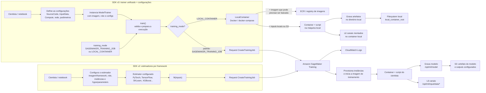
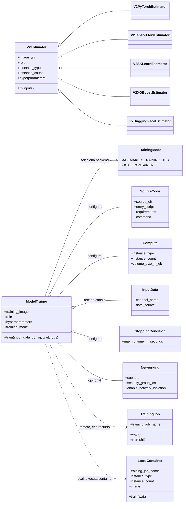
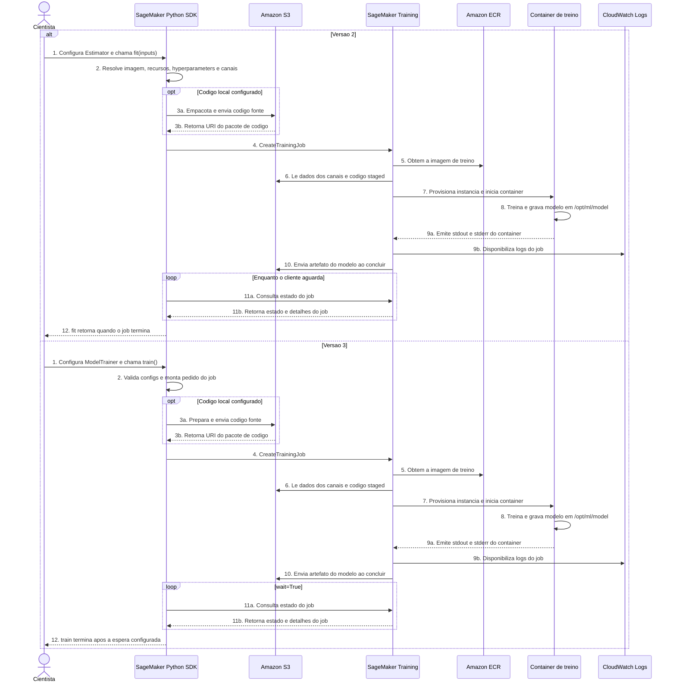

# Relatório: criação de Training Jobs com SageMaker Python SDK v3

**Escopo:** diferenças da API v2 para a v3 relevantes à criação e execução de
training jobs, com base no código, na documentação e nos exemplos deste checkout.

## Resumo executivo

A mudança principal não é uma alteração no serviço Amazon SageMaker Training,
mas uma mudança significativa na API Python usada para configurar e submeter
jobs. Na v2, o fluxo habitual era criar um `Estimator` específico de framework
e chamar `fit()`. Na v3, o fluxo é centralizado em `ModelTrainer`, com
configurações explícitas para imagem, código, dados, computação, rede e
parâmetros; o job é iniciado por `train()`.

O serviço ainda executa um SageMaker Training Job. A role IAM, as imagens de
treinamento, os canais de entrada, os artefatos no S3, a infraestrutura de
computação e os limites/quota da conta continuam sendo decisões operacionais
essenciais. A v3 organiza e valida a configuração em objetos Python e usa
recursos do SageMaker Core para interagir com a API AWS.

**Aviso de migração:** as interfaces antigas `Estimator`, `Model`, `Predictor`
e subclasses não são suportadas na v3. Não se trata de uma atualização
compatível em que basta trocar a versão do pacote.

## O que mudou

| Tema | SDK v2 | SDK v3 |
|---|---|---|
| Interface de treinamento | `Estimator`, `PyTorch`, `TensorFlow`, `SKLearn`, `XGBoost`, `HuggingFace` etc. | Classe unificada `ModelTrainer` |
| Submissão | `estimator.fit(...)` | `trainer.train(input_data_config=[...])` |
| Imagem | Geralmente definida na classe do estimador ou em `image_uri` | `training_image` explícita, ou configuração especializada como JumpStart |
| Código | `entry_point` e `source_dir` no estimador | `SourceCode(source_dir=..., entry_script=...)` |
| Entrada de dados | Dicionário e `TrainingInput` | `InputData(channel_name=..., data_source=...)` ou `Channel` |
| Computação | `instance_type`, `instance_count` como argumentos do estimador | `Compute(instance_type=..., instance_count=...)` |
| Tempo máximo | `max_run` | `StoppingCondition(max_runtime_in_seconds=...)` |
| Sessão/utilitários | `sagemaker.Session`, `get_execution_role`, `sagemaker.image_uris` | Imports explícitos de `sagemaker.core` |
| Organização do SDK | Biblioteca monolítica | Pacotes `sagemaker-core`, `sagemaker-train`, `sagemaker-serve` e `sagemaker-mlops` |

O objetivo prático é reduzir as classes específicas por framework e aproximar
as configurações dos objetos da API SageMaker. O cientista passa a escolher e
configurar explicitamente a imagem compatível com o framework, em vez de
esperar que uma classe específica de framework encapsule todo esse trabalho.

## Arquitetura: componentes e responsabilidades

1. **Código cliente (notebook, script ou pipeline):** instancia `ModelTrainer`,
   valida os objetos de configuração e pede a submissão.
2. **SDK SageMaker Core/Train:** resolve configurações, prepara o pedido de
   criação e usa a sessão AWS. Quando código local é configurado, o SDK o
   prepara para disponibilização ao container no fluxo do job.
3. **Amazon SageMaker Training:** recebe o pedido, provisiona a capacidade
   especificada, inicia o container com a imagem escolhida e acompanha o job.
4. **Container de treinamento:** lê os canais, executa o script/command,
   registra logs e grava os artefatos esperados nos diretórios do SageMaker.
5. **S3 e CloudWatch:** armazenam dados/artefatos conforme a configuração; os
   logs do container são disponibilizados pelo serviço no CloudWatch Logs.

O SDK não substitui o contrato do container. A imagem deve ser compatível com
o tipo de instância, região, framework, versão do Python/CUDA e modo de
treinamento. Em uma imagem customizada, o cientista também é responsável por
garantir que o processo de treinamento consiga iniciar e produzir o modelo
esperado.

### Desenho da arquitetura e da execução

O desenho abaixo destaca que a grande mudança está na camada Python que
prepara a configuração. Na v3, `training_mode` também determina onde o
container será executado: o padrão é submeter um job remoto ao SageMaker; com
`Mode.LOCAL_CONTAINER`, o SDK executa a imagem via Docker na máquina local e
não cria um Training Job remoto.



**Como ler:** na v2, subclasses de `Estimator` costumavam reunir a
configuração de framework no próprio estimador, e depois `fit()` submetia o
job. Na v3, a sequência também começa com o cientista: ele define as
configurações, passa os valores/objetos ao construir `ModelTrainer` e então
chama `train()`. As configurações foram separadas em objetos tipados, mas não
são executadas em paralelo com o trainer. O `training_mode` define se
`train()` usa Docker local ou prepara/submete um job remoto. O caminho local
usa Docker e filesystem local, não passa pelo serviço Training do SageMaker e
não tem o mesmo ciclo de vida remoto, billing de instâncias gerenciadas ou
integração automática de logs. A imagem e o contrato do container continuam
centrais nos dois caminhos.

### Executar localmente com Docker (Local Mode)

Sim. No `ModelTrainer` v3, o modo local é selecionado explicitamente pelo
parâmetro `training_mode=Mode.LOCAL_CONTAINER`. Ele executa a imagem de
treinamento em container Docker na máquina em que o Python está rodando. Para
usar o serviço AWS remoto, omita esse parâmetro ou use
`Mode.SAGEMAKER_TRAINING_JOB`, que é o padrão.

**"Local" significa o host do processo Python, não necessariamente seu
notebook pessoal.** Se você executa o script no VS Code do seu laptop, o
container roda no Docker do laptop. Se executa o notebook em uma instância
SageMaker Studio ou em outra máquina EC2, o container roda no Docker desse
ambiente. Mesmo nesse segundo caso, `LOCAL_CONTAINER` não cria um SageMaker
Training Job nem solicita instâncias de treinamento ao serviço.

Você não precisa escrever um `docker-compose.yml`: a SDK cria a configuração
temporária e invoca `docker compose`/`docker-compose` no host. A imagem do ECR
é baixada para o daemon Docker desse host se ainda não estiver disponível; o
SageMaker Training não executa o container nesse modo.

Exemplo de configuração local:

```python
from sagemaker.core import image_uris
from sagemaker.core.helper.session_helper import Session
from sagemaker.core.training.configs import Compute, InputData, SourceCode
from sagemaker.train.model_trainer import Mode, ModelTrainer

session = Session()
region = session.boto_region_name

training_image = image_uris.retrieve(
    framework="pytorch",
    region=region,
    version="2.0.0",
    py_version="py310",
    instance_type="ml.m5.xlarge",
    image_scope="training",
)

trainer = ModelTrainer(
    training_mode=Mode.LOCAL_CONTAINER,
    training_image=training_image,
    sagemaker_session=session,
    source_code=SourceCode(
        source_dir="./training",
        entry_script="train.py",
    ),
    compute=Compute(
        instance_type="local_cpu",
        instance_count=1,
    ),
    input_data_config=[
        InputData(
            channel_name="train",
            data_source="./data/train",
        )
    ],
    base_job_name="local-training",
)

trainer.train()
```

No exemplo, `image_uris` precisa ser importado com
`from sagemaker.core import image_uris`. `local_cpu` indica execução local em
CPU; para uma máquina com GPU Docker configurada, o guia apresenta
`local_gpu`. O uso de `Mode.LOCAL_CONTAINER` seleciona o backend Docker. A
contagem de instâncias maior que um pode iniciar containers locais
coordenados, mas distribuição exige um driver/framework compatível (por
exemplo `Torchrun`) e recursos locais suficientes.

**Pré-requisitos e diferenças importantes:**

- Docker deve estar instalado e em execução. Para GPU, a máquina, Docker e
  runtime GPU também precisam estar corretamente configurados.
- A imagem tem que ser acessível ao daemon Docker local ou baixável do
  registry. Se vier do ECR, credenciais AWS e rede podem ser necessárias para
  autenticar e baixar a imagem. Isso é acesso ao registry, não submissão de um
  job de treinamento remoto.
- Dados locais são montados diretamente no container. Inputs S3 ainda podem
  ser usados, mas dependem de credenciais/sessão e de acesso à AWS.
- O `local_container_root` do trainer controla o diretório base local de
  execução/artefatos; no código atual seu default é o diretório de trabalho
  atual (`os.getcwd()`). Preserve e inspecione esse diretório conforme o
  script/container escreve seus outputs.
- Local Mode é apropriado para desenvolvimento e depuração com workload
  pequeno. Não provisiona instâncias de treinamento SageMaker e não valida
  quotas, comportamento de capacidade remota, IAM da execution role no
  container, VPC do job ou integração completa com o serviço.
- Não há cobrança por instâncias do SageMaker Training nesse modo, porque
  elas não são criadas. Ainda pode haver custos dos recursos usados pelo host
  (por exemplo, Studio/EC2 se o Python estiver rodando na AWS), tráfego,
  armazenamento S3 e outros serviços AWS acessados pelo script.
- `instance_preferences` não é suportado no Local Mode; use um único
  `instance_type` local (`local_cpu` ou `local_gpu`).
- Um resultado local não substitui um teste remoto: diferenças de hardware,
  montagem, permissões e ambiente podem alterar o comportamento.

Use Local Mode para detectar problemas de dependências, entrypoint e leitura
dos canais rapidamente; antes de promover o experimento, repita com um job
remoto pequeno em SageMaker.

### Diagrama de classes: estimadores v2 versus ModelTrainer v3

Este diagrama representa os papéis conceituais da API, não uma herança
compatível entre versões. Os estimadores v2 específicos deixaram de ser o
modelo de API v3; `ModelTrainer` é a interface comum e recebe configurações
separadas por responsabilidade. O prefixo `V2` identifica classes da versão
anterior; as classes sem prefixo representam os componentes v3. O prefixo é
apenas uma convenção visual do diagrama.



**Implicação para a migração:** parâmetros que antes estavam espalhados no
construtor de subclasses agora são agrupados por finalidade. `ModelTrainer`
não é uma subclasse v3 de `PyTorch` ou `SKLearn`: o cientista informa a imagem
apropriada e os objetos de configuração. O `TrainingJob` representa o recurso
criado no serviço; ele não é a configuração do trainer. No modo local, o
backend é `LocalContainer` e não há `TrainingJob` criado no serviço AWS.

## Fluxo de treinamento remoto: v2 e v3

Quando o modo é remoto, as duas versões usam o serviço Amazon SageMaker
Training e criam um Training Job. O que muda é a forma como o código cliente
expressa a configuração e chama a SDK: em v2, normalmente um `Estimator`
framework-specific recebe parâmetros e `fit()` inicia o fluxo; em v3,
`ModelTrainer` recebe configurações mais explícitas e `train()` inicia o
fluxo. Após a submissão, o serviço provisiona a infraestrutura, executa a
imagem e grava os artefatos. A execução não acontece na máquina cliente.

Os números no diagrama representam **etapas lógicas**, repetidas nos dois
ramos para facilitar a comparação. Subetapas opcionais usam sufixos, como
`3a` e `3b`.



### Descrição numerada das etapas

1. **Configuração e chamada pelo cientista.** Na v2, o cientista configura o
   `Estimator` (ou uma classe específica de framework), seleciona imagem,
   role, instâncias e hyperparameters e chama `fit(inputs)`. Na v3, configura
   o `ModelTrainer` e seus objetos de configuração, define a imagem e chama
   `train()`. Nos dois casos, o código cliente inicia a solicitação; o
   treinamento ainda não está sendo executado na máquina do cientista.
2. **Preparação pelo SDK.** A SDK resolve e valida os valores necessários
   para compor a solicitação: imagem, recursos, canais, hyperparameters,
   role, saídas e demais opções. A v2 costuma reunir mais configurações no
   estimator; a v3 organiza partes da configuração em objetos como
   `Compute`, `InputData`, `SourceCode` e `StoppingCondition`.
3. **Preparação opcional do código local.** Se o projeto fornece script ou
   diretório de código local, a SDK o prepara e envia para um bucket S3
   acessível ao job. **3a** representa o envio; **3b**, o retorno/uso da URI
   que será referenciada na configuração do job. Se o código já estiver
   incluído na imagem ou o algoritmo não exigir upload de código, esta etapa
   pode não ocorrer.
4. **Criação do Training Job.** A SDK envia `CreateTrainingJob` ao serviço
   SageMaker. A identidade cliente precisa ter autorização para criar o job e
   passar a execution role (`iam:PassRole`). A chamada aceita a solicitação;
   ainda não significa que o treinamento terminou ou que terá sucesso.
5. **Disponibilização da imagem.** O serviço obtém a imagem de treinamento
   configurada, normalmente do Amazon ECR. A imagem deve existir na região
   correta, ser acessível ao serviço e ser compatível com o framework,
   arquitetura e instância selecionados.
6. **Disponibilização dos dados e do código.** O serviço prepara os canais de
   entrada indicados no request e disponibiliza os dados ao container nos
   paths de canal do SageMaker. Se houve upload de código, esse pacote também
   fica acessível ao job. A execution role do job precisa das permissões para
   ler os recursos envolvidos.
7. **Provisionamento e inicialização.** O SageMaker aloca a capacidade
   gerenciada conforme tipo/quantidade de instâncias, rede e configurações do
   job; em seguida, inicia o container. Pode haver tempo de espera por
   capacidade e download de dados/imagem antes de o script começar.
8. **Execução do treinamento.** O script ou algoritmo roda dentro do
   container nas instâncias provisionadas. O código lê os canais e deve
   persistir o artefato do modelo no diretório esperado, normalmente
   `/opt/ml/model`. O framework e o código do usuário controlam o cálculo e
   as métricas.
9. **Emissão e consulta de logs.** **9a:** o processo do container emite
   `stdout`/`stderr`. **9b:** o SageMaker disponibiliza esses logs no
   CloudWatch Logs. Quando a SDK aguarda com logs habilitados, ela acompanha
   essa saída para o cliente; os logs continuam disponíveis no serviço para
   investigação.
10. **Persistência do artefato.** Ao concluir com sucesso, o serviço empacota
    e envia o modelo produzido para o caminho S3 configurado. Outputs
    adicionais podem ter destinos/configuração separados. Confirme estado do
    job e existência do artefato antes de consumi-lo.
11. **Acompanhamento do estado.** Quando a chamada está configurada para
    esperar, a SDK consulta o serviço em intervalos e recebe estados/detalhes
    até o job finalizar. **11a** é a consulta e **11b** é a resposta. Se o
    cliente usar `wait=False` na v3, a submissão retorna sem aguardar essa
    etapa; o job continua executando no SageMaker. No diagrama, esta fase foi
    colocada depois das operações do serviço para facilitar a leitura; na
    execução real, as consultas ocorrem enquanto o job está sendo processado.
12. **Retorno ao cliente.** Depois da espera configurada, o controle volta ao
    código chamador. A semântica exata do retorno depende da versão/API: neste
    checkout, `ModelTrainer.train()` não retorna o objeto `TrainingJob` no
    fluxo standalone, embora mantenha internamente uma referência privada.
    Registre/obtenha o nome do job por um caminho suportado e use recursos AWS
    para monitoramento posterior.

**Pontos importantes para interpretar o fluxo:**

- Os passos de upload de código são condicionais: acontecem quando o projeto
  fornece código local para a SDK preparar. Com imagem que já contém o
  algoritmo ou script, essa etapa pode não se aplicar.
- A role de execução é usada pelo serviço/container para acessar os recursos
  necessários; as credenciais do cliente autorizam a chamada e o
  `iam:PassRole`. Não confunda as duas identidades.
- ECR, S3 e CloudWatch estão representados como serviços de suporte. O
  treinamento propriamente dito é executado pela infraestrutura provisionada
  pelo SageMaker, não pelo processo Python que chamou `fit()`/`train()`.
- A espera é configurável nas duas versões. Na implementação v3 deste
  checkout, `train(wait=True, logs=True)` aguarda e acompanha logs por padrão;
  com `wait=False`, a chamada submete o job sem aguardar sua conclusão.
- Em v3, o modo `LOCAL_CONTAINER` desvia desse fluxo: usa Docker no host do
  processo Python, não chama `CreateTrainingJob` e não provisiona um Training
  Job gerenciado. Consulte a seção de Local Mode acima.

### Entradas e saídas do container

- Cada canal `InputData` fica disponível em
  `/opt/ml/input/data/<channel_name>`; o SDK também expõe
  `SM_CHANNEL_<CHANNEL>` (nome do canal em maiúsculas).
- O código de treinamento preparado pela SDK fica em
  `/opt/ml/input/data/code`.
- O diretório padrão para o modelo treinado é `/opt/ml/model` (também
  indicado por `SM_MODEL_DIR`). O SageMaker empacota e envia o modelo para o
  S3 configurado ao final de um job bem-sucedido.
- Hyperparameters em modo padrão são disponibilizados como argumentos CLI e
  como JSON na variável `SM_HPS`. Em modo `SourceCode(command=...)`, os
  hyperparameters de alto nível não são anexados ao comando; o código deve
  lê-los de `SM_HPS` se precisar deles.

## Preparação do ambiente

O checkout analisado requer Python 3.10 ou superior. A opção simples para um
ambiente novo é instalar o pacote agregado:

```bash
python -m pip install --upgrade sagemaker
```

Use um ambiente virtual e fixe versões aprovadas pelo projeto/equipe para
execuções reproduzíveis. O SDK v3 e o SDK v2 têm APIs incompatíveis; evite
misturar código de ambos no mesmo fluxo sem uma estratégia de migração
explícita.

No estado atual deste checkout, importe `ModelTrainer` de `sagemaker.train`,
mas importe configurações de treinamento de `sagemaker.core.training.configs`.
`sagemaker.train.configs` existe como shim de compatibilidade depreciado e
emite `DeprecationWarning`; exemplos antigos do próprio repositório ainda
usam esse caminho legado.

## Exemplo recomendado: job remoto com código próprio

Pré-requisitos:

- Credenciais AWS configuradas para o processo cliente e uma região definida.
- Uma execution role de SageMaker acessível na conta/região.
- Permissão `iam:PassRole` para o usuário ou role que submete o job; a role de
  execução precisa das permissões necessárias para SageMaker e para os
  buckets/recursos usados.
- Imagem de treinamento existente e compatível com framework, região e tipo
  de instância.
- Dados em um caminho S3 que a role de execução possa ler.

```python
from sagemaker.core.helper.session_helper import Session
from sagemaker.core.training.configs import (
    Compute,
    InputData,
    OutputDataConfig,
    SourceCode,
    StoppingCondition,
)
from sagemaker.train import ModelTrainer

session = Session()
role_arn = "arn:aws:iam::123456789012:role/SageMakerExecutionRole"

trainer = ModelTrainer(
    training_image=(
        "123456789012.dkr.ecr.us-west-2.amazonaws.com/"
        "my-pytorch-training:tag-aprovada"
    ),
    role=role_arn,
    sagemaker_session=session,
    source_code=SourceCode(
        source_dir="./training",
        entry_script="train.py",
        requirements="requirements.txt",
        ignore_patterns=[".env", ".git", "__pycache__", "data"],
    ),
    compute=Compute(
        instance_type="ml.m5.xlarge",
        instance_count=1,
        volume_size_in_gb=50,
    ),
    input_data_config=[
        InputData(
            channel_name="train",
            data_source="s3://meu-bucket/datasets/experimento/train/",
        ),
        InputData(
            channel_name="validation",
            data_source="s3://meu-bucket/datasets/experimento/validation/",
        ),
    ],
    output_data_config=OutputDataConfig(
        s3_output_path="s3://meu-bucket/experimentos/modelos/",
    ),
    hyperparameters={
        "epochs": 10,
        "learning_rate": 0.001,
        "batch_size": 64,
    },
    stopping_condition=StoppingCondition(max_runtime_in_seconds=7200),
    base_job_name="classificador-experimento",
)

# Submete o job remoto; aguarda o término e acompanha logs.
trainer.train(wait=True, logs=True)
```

O script `./training/train.py` deve reconhecer os dados em
`/opt/ml/input/data/train` e `/opt/ml/input/data/validation` (ou obter os
caminhos por `SM_CHANNEL_TRAIN` e `SM_CHANNEL_VALIDATION`), processar os
hyperparameters e salvar o artefato do modelo em `/opt/ml/model`. Exemplo
mínimo de leitura dos caminhos:

```python
import json
import os

train_dir = os.environ["SM_CHANNEL_TRAIN"]
validation_dir = os.environ["SM_CHANNEL_VALIDATION"]
hyperparameters = json.loads(os.environ["SM_HPS"])
model_dir = os.environ["SM_MODEL_DIR"]
```

O código real deve implementar a leitura do dataset, treinamento,
avaliação/checkpoint se necessário e persistência do modelo. Em particular,
escrever apenas em uma pasta local arbitrária não garante que o artefato seja
capturado pelo SageMaker.

### Acompanhar o job e o artefato

- `train()` aguarda por padrão (`wait=True`) e exibe logs por padrão
  (`logs=True`). Use `wait=False` para submeter e seguir com o cliente; nesse
  caso, não espere que os logs sejam transmitidos por essa chamada.
- **`train()` não retorna o objeto do training job** neste checkout. Portanto,
  não use `job = trainer.train()` esperando acessar `job.name`; esse padrão
  aparece no quickstart local, mas não corresponde à implementação atual.
- O trainer mantém a referência do último job em
  `trainer._latest_training_job`, que é um atributo privado e não deve ser
  tratado como API pública estável. Planeje monitoramento/recuperação usando o
  nome do job registrado no log/console e as APIs de recursos do SageMaker.
- O modelo de saída (`model.tar.gz`) e o output adicional do container são
  artefatos diferentes. Configure o S3 de saída e confirme o estado final do
  job antes de consumir o modelo; uma submissão aceita não significa
  treinamento concluído com sucesso.

## Decisões de arquitetura e execução para o cientista

### Imagem e dependências

- Reutilize uma imagem oficial/validada quando possível; se usar imagem
  customizada, versione-a no ECR e fixe tag ou digest imutável.
- A imagem fixada deve suportar os recursos solicitados. Não presuma que uma
  troca de `instance_type` mantém compatibilidade (por exemplo, CPU/GPU,
  arquitetura, memória e CUDA).
- Dependências do script podem ser empacotadas no container ou declaradas em
  `requirements.txt` por `SourceCode`. Para ambientes críticos/reprodutíveis,
  prefira imagem e dependências versionadas; a instalação no início do job
  pode depender de acesso à rede e de disponibilidade do índice de pacotes.
- Exclua dados grandes, segredos e arquivos desnecessários do `source_dir`.
  Dados de treino devem ser canais de entrada, não cópias acidentais do
  diretório de código.

### Dados e modos de entrada

- Use nomes de canais estáveis (`train`, `validation`, `test`) e confirme o
  caminho montado e o acesso da role antes de escalar.
- `training_input_mode` aceita `File`, `Pipe` e `FastFile`; `File` é o padrão
  no trainer. Escolha outro modo apenas se a imagem e o código souberem
  consumir o formato/stream correspondente.
- Caminhos locais podem ser úteis em Local Mode ou para dados que o SDK
  prepara, mas jobs remotos precisam de uma origem acessível ao serviço, em
  geral S3 ou filesystem suportado/configurado.

### Computação, custo e duração

- Declare `Compute` conscientemente: tipo, quantidade de instâncias, tamanho
  de volume e, quando aplicável, spot, grupos de instâncias ou capacidade
  reservada.
- Este checkout documenta defaults para uma instância `ml.m5.xlarge` e uma
  duração máxima de uma hora. Para experimentos reais, explicite os valores
  relevantes e não dependa implicitamente de defaults.
- Distribuição exige mais do que `instance_count > 1`: o script/framework
  precisa inicializar processos e coordenar o treinamento. O SDK oferece
  configurações de distribuição, como `Torchrun`, mas o código precisa ser
  compatível.
- `enable_managed_spot_training` pode reduzir custo, mas o job pode ser
  interrompido. Configure checkpoint e recuperação no código antes de
  habilitá-lo.
- Verifique quotas, disponibilidade e preço na região antes de iniciar
  workloads grandes. Jobs de treinamento cobram pelos recursos provisionados;
  jobs longos ou hiperparameter tuning podem multiplicar o custo.

### Segurança e rede

- Separe a identidade do cliente que chama a API da execution role usada pelo
  job. O cliente precisa autorização para criar o job e passar a role; o job
  precisa permissões limitadas para ler dados e escrever artefatos/logs.
- Use `Networking` para subnets e security groups quando necessário. Se
  habilitar isolamento de rede, o container não poderá fazer chamadas de
  rede arbitrárias; planeje previamente download de dependências e
  comunicação entre workers.
- Configure criptografia KMS para volumes e artefatos conforme os requisitos
  do projeto e valide que as roles têm as permissões KMS/S3 necessárias.
- Não coloque credenciais, tokens ou segredos no código, em hyperparameters,
  em variáveis de ambiente persistidas ou nos logs.

### Execução local, pipelines e experimentação

- `training_mode=Mode.LOCAL_CONTAINER` permite desenvolvimento/teste com
  Docker local; use `Compute(instance_type="local_cpu")` ou
  `Compute(instance_type="local_gpu")`. O diagrama e a seção Local Mode acima
  descrevem os limites e pré-requisitos.
- Local Mode não cria Training Job no serviço nem reproduz capacidade, rede,
  IAM e todos os comportamentos remotos. Use-o como teste rápido, não como
  certificação final.
- `PipelineSession` permite construir um passo de pipeline em vez de
  submeter imediatamente um job interativo. O comportamento de `train()` é
  interceptado pela sessão e não equivale a aguardar um treinamento remoto.
- Para busca de hyperparameters, tuning, JumpStart e distribuição, consulte
  os exemplos específicos da v3; não transfira automaticamente os objetos
  auxiliares e padrões de V2.

## Plano de migração de V2 para V3

1. **Inventariar a API antiga:** localizar classes de estimador, `fit()`,
   `TrainingInput`, `entry_point`, `source_dir`, configurações de instance,
   spot, rede, output e callbacks/monitoramento.
2. **Isolar o ambiente:** criar ambiente Python separado, instalar v3 e
   validar versões/imagens usadas em produção.
3. **Substituir a classe:** mapear o estimador para `ModelTrainer`; selecionar
   explicitamente a imagem e preservar o framework/versão usada.
4. **Migrar argumentos em objetos:** criar `SourceCode`, `InputData`,
   `Compute`, `StoppingCondition`, `Networking`, configurações de output e
   checkpoint conforme aplicável.
5. **Revisar o script:** testar paths de canais, leitura dos hyperparameters,
   escrita em `/opt/ml/model`, dependências e logs.
6. **Executar primeiro um job pequeno:** poucos dados, instância econômica,
   tempo limitado e verificação do artefato final no S3.
7. **Comparar resultados e custos:** confirmar que métricas, pré-processamento,
   seed, imagem, parâmetros, checkpoints e localização de saída continuam
   equivalentes antes de migrar o workload de produção.

Referências úteis para o mapeamento:

| Padrão V2 | Padrão V3 |
|---|---|
| `Estimator(...); estimator.fit({"train": "s3://..."})` | `ModelTrainer(...); trainer.train(input_data_config=[InputData(...)])` |
| `entry_point="train.py", source_dir="./src"` | `SourceCode(entry_script="train.py", source_dir="./src")` |
| `instance_type=..., instance_count=...` | `Compute(instance_type=..., instance_count=...)` |
| `max_run=3600` | `StoppingCondition(max_runtime_in_seconds=3600)` |
| `TrainingInput(s3_data=...)` | `InputData(channel_name=..., data_source=...)` |
| `sagemaker.Session()` | `sagemaker.core.helper.session_helper.Session()` |
| `sagemaker.image_uris.retrieve(...)` | `sagemaker.core.image_uris.retrieve(...)` |

## Referências neste repositório

- [README.rst](./README.rst): anúncio v3, quebra de compatibilidade e visão geral.
- [CHANGELOG.md](./CHANGELOG.md): notas de lançamento; v3.0.0 e v3.0.1
  descrevem o marco da mudança e a composição dos pacotes.
- [docs/training/index.rst](./docs/training/index.rst): API de treinamento,
  exemplos, modos local/distribuído e tabela de migração.
- [docs/quickstart.rst](./docs/quickstart.rst): instalação e fluxo rápido; o
  trecho que atribui o retorno de `train()` a `training_job` não corresponde
  à implementação de `ModelTrainer.train()` examinada neste checkout.
- [sagemaker-train/src/sagemaker/train/model_trainer.py](./sagemaker-train/src/sagemaker/train/model_trainer.py):
  implementação de `ModelTrainer`, composição do pedido, submissão e espera.
- [sagemaker-core/src/sagemaker/core/training/configs.py](./sagemaker-core/src/sagemaker/core/training/configs.py):
  tipos de configuração atuais para código, dados e computação.
- [sagemaker-train/src/sagemaker/train/configs.py](./sagemaker-train/src/sagemaker/train/configs.py):
  shim depreciado de compatibilidade para as configurações movidas ao Core.
- [v3-examples/training-examples/](./v3-examples/training-examples/):
  notebooks com exemplos de treinamento customizado, distribuição, local,
  JumpStart e hyperparameters.

**Nota de versão:** o checkout informa `VERSION` como `3.27.0`, embora o
changelog mantenha entradas explícitas para as versões 3.0.x e 3.1.0. Este
relatório descreve o comportamento e as APIs presentes no checkout analisado;
confirme a documentação e as dependências da versão que será fixada no
ambiente da equipe antes da implantação.
